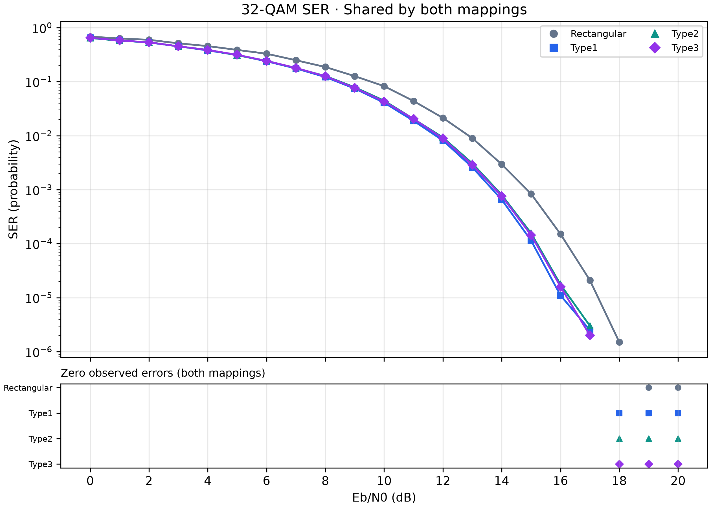
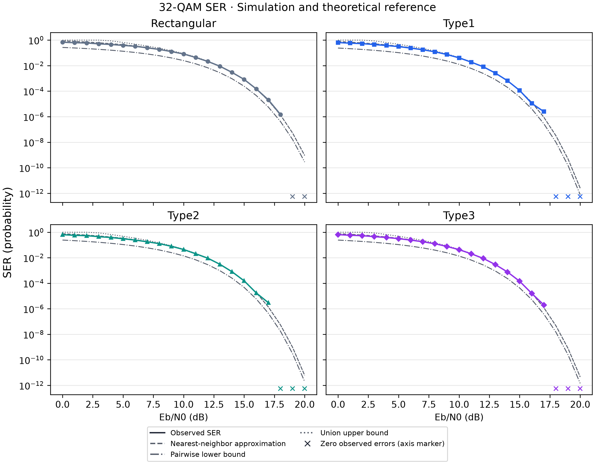
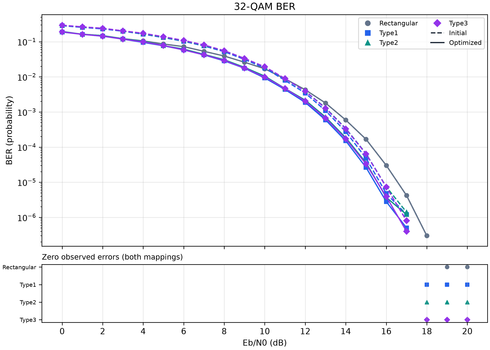

# 디지털통신 시스템설계 10조 · 팀원 B 보고서 초안

## 3.2~3.5 성상도별 비트 매핑

32-QAM의 각 성상점에 5비트 라벨을 한 개씩 할당하였다. 초기 라벨은 A가 부여한 `point_id` 0~31을 5자리 이진수로 표현한 값이다. Rectangular의 `point_id`는 교수님 원본 배열 순서이며, Type1~3의 `point_id`는 A의 확정 CSV에서 가져왔다. 라벨을 교환하는 동안 원시·정규화 좌표와 `point_id`를 유지하였다. 네 방식 각각에서 `00000`부터 `11111`까지의 라벨을 정확히 한 번씩 사용한다. [확정 좌표](../data/constellations.csv) · [성상도별 전체 32개 라벨](../data/mapped_constellations.csv)

최적화는 최소거리 점 쌍의 해밍 거리 합을 줄이는 시뮬레이티드 어닐링(Simulated Annealing)으로 수행하였다. 한 번의 탐색은 두 점의 라벨을 교환하며, 비트 라벨의 순열을 유지한다. 비용 증가량이 $\Delta J>0$일 때 교환을 받아들일 확률은 $\exp(-\Delta J/T)$이다. 각 탐색의 온도 $T$는 2에서 0.08까지 기하급수적으로 낮아지며, 최대 12,000번의 교환을 시도한다. 초기 배치 한 개와 무작위 배치 23개를 시작점으로 사용하며, 하한에 도달하면 탐색을 종료한다. 초기 매핑을 최우수 후보로 포함하였다. 탐색 시드는 Rectangular, Type1, Type2, Type3 순서로 20261128~20261131이다. [매핑 최적화 코드](../simulation/mapping_optimizer.py#L124)

아래는 네 방식의 대표 최소거리 쌍이다. 좌표는 정규화 전 $(I,Q)$이고 라벨은 표의 점 순서와 대응한다.

| 절 | 성상도 | `point_id`와 좌표 | 초기 라벨 쌍 | 최종 라벨 쌍 | 해밍 거리 변화 |
| --- | --- | --- | --- | --- | ---: |
| 3.2 | Rectangular | 0 $(1,1)$, 1 $(1,3)$ | `00000`, `00001` | `00000`, `00001` | 1 → 1 |
| 3.3 | Type1 | 1 $(-5,-1)$, 2 $(-5,1)$ | `00001`, `00010` | `00010`, `00000` | 2 → 1 |
| 3.4 | Type2 | 1 $(-6,0)$, 2 $(-6,2)$ | `00001`, `00010` | `11000`, `10000` | 2 → 1 |
| 3.5 | Type3 | 1 $(-5,-2)$, 2 $(-5,0)$ | `00001`, `00010` | `00010`, `00110` | 2 → 1 |

Rectangular의 초기 매핑은 52개 최소거리 쌍 전부에서 라벨이 1비트만 다르므로 목적함수의 하한에 도달한다. 따라서 초기 매핑을 최종 매핑으로 유지하였다. Type1~3에서는 초기보다 비용이 낮은 매핑을 선택하였다. 세 방식의 완전 Gray 매핑은 이번 탐색에서 찾지 못했으며, 완전 Gray 매핑의 존재 여부와 목적함수의 전역 최적성은 미확정이다. [최종 매핑 CSV](../data/mapped_constellations.csv)

## 4.3 비트 오류율 이론

성상점 $i$의 정규화 복소 좌표를 $s_i$, 5비트 라벨을 $b_i$로 둔다. 서로 다른 두 점 사이의 최소 유클리드 거리를 $d_{\min}$이라 하면, 인접 집합은 $\mathcal E=\{(i,j):i<j,\ |s_i-s_j|=d_{\min}\}$이다. 구현은 공통 정규화 계수를 곱하기 전 정수 격자의 거리 제곱을 비교해 최소거리 동률을 정확히 판정한다. 해밍 거리 $d_H(b_i,b_j)$는 두 라벨에서 값이 다른 비트의 개수이다. 이 값이 1인 인접 쌍을 Gray edge로 센다.

최적화의 가중치는 인접 쌍에 1, 그 밖의 쌍에 0을 부여한다. 목적함수 $J=\sum_{(i,j)\in\mathcal E}d_H(b_i,b_j)$, 평균 인접 해밍 거리 $J/|\mathcal E|$, Gray edge 비율 $|\{(i,j)\in\mathcal E:d_H(b_i,b_j)=1\}|/|\mathcal E|$를 사용하였다. 최소거리 경쟁점은 송신점에서 결정 경계까지의 거리가 짧아 잡음에 의해 혼동되기 쉽다. 이 목적함수에는 수신점별 전이확률과 더 먼 점으로 오판하는 경우의 비용이 포함되지 않으므로, BER 개선은 실험값으로 확인한다. [인접 정의 및 집계 코드](../simulation/mapping_optimizer.py#L108)

| 성상도 | 인접 쌍 수 | 목적함수 전 → 후 | 평균 인접 해밍 거리 전 → 후 | Gray edge 비율 전 → 후 |
| --- | ---: | ---: | ---: | ---: |
| Rectangular | 52 | 52 → 52 | 1.0000 → 1.0000 | 100.00% → 100.00% |
| Type1 | 52 | 110 → 60 | 2.1154 → 1.1538 | 30.77% → 92.31% |
| Type2 | 50 | 107 → 58 | 2.1400 → 1.1600 | 32.00% → 92.00% |
| Type3 | 51 | 112 → 58 | 2.1961 → 1.1373 | 31.37% → 86.27% |

송신점 $i$가 균등하고 판정점이 $\hat i$일 때, 이론적 오류율은 다음과 같다.

$$
P_s=\frac{1}{32}\sum_i\sum_{j\ne i}P(\hat i=j\mid i),\qquad
P_b=\frac{1}{32\cdot 5}\sum_i\sum_{j\ne i}P(\hat i=j\mid i)\,d_H(b_i,b_j).
$$

좌표, 심볼 선택 확률, 채널, 판정 규칙을 동일하게 두면 전이확률 $P(\hat i=j\mid i)$는 라벨 교환의 영향을 받지 않는다. 따라서 SER은 유지된다. BER에서는 같은 오판도 두 점의 라벨 차이에 따라 1~5개의 비트 오류로 집계되므로 라벨 교환에 따라 달라질 수 있다. [매핑 지표 CSV](../results/metrics/mapping_metrics.csv)

## 5. 실험 조건

A의 최종 좌표는 커밋 `2a5d016`에서 가져왔다. 성상도별 점 32개, 좌표 중복 여부, 원시 좌표 범위와 홀짝 조건, 정규화 후 평균 에너지 $E_s=1$을 검증하였다. [입력 좌표](../data/constellations.csv) · [기하 지표](../results/metrics/geometry_metrics.csv)

| 항목 | 설정 |
| --- | --- |
| 변조 및 송신점 | 비부호화 32-QAM, 심볼당 $k=5$비트, 각 성상점 확률 $1/32$ |
| 채널 | 영평균 AWGN, I/Q축마다 독립적인 정규 표본 |
| 수신 판정 | 정규화 좌표 32점에 대한 최소 유클리드 거리 판정 |
| $E_b/N_0$ | 0~20 dB, 양 끝 포함, 1 dB 간격 |
| 난수 | C++ `std::mt19937`, 지점별 시드 `20261128 + ebn0_db` |
| 종료 기준 | 성상도·SNR별로 심볼 오류 2,000회 또는 전송 심볼 2,000,000개에 먼저 도달할 때 종료 |
| 비교 조건 | 같은 성상도·SNR의 두 매핑에 송신점·잡음·판정 및 전송 심볼 수를 공통 적용 |

비부호화 조건에서 $E_b=E_s/5$이고, $\gamma_b=10^{(E_b/N_0)_{\mathrm{dB}}/10}$은 선형 $E_b/N_0$이다. $E_s=1$이므로 $N_0=1/(5\gamma_b)$이며, 각 실수축에 적용하는 잡음 분산은 $\sigma^2=N_0/2=1/(10\gamma_b)$이다. 프로그램은 0 dB일 때 축별 설정 분산이 0.1임을 검사하고, 표준편차 $\sigma$를 정규분포에 전달한다. 관측 SER은 심볼 오류 수를 실제 전송 심볼 수 $N$으로 나눈 값이고, 관측 BER은 비트 오류 수를 $5N$으로 나눈 값이다. 4종 × 21지점 × 2매핑으로 총 168행을 기록하였다. [C++ 실험 루프](../simulation/LinkLevelSimulation/rectangular_experiment.cpp#L177) · [실험 CSV](../results/metrics/simulation_results.csv)

## 6. 시뮬레이터와 원본 변경

교수님 원본 `main.cpp`의 활성 경로는 `QAM32(3)`으로 내장 Type3을 선택하고, $E_s/N_0$ 0~20 dB를 2 dB 간격으로 지점당 100,000심볼 실행한다. 원본은 평균 심볼 에너지를 1로 정규화한 뒤 축별 잡음 표준편차를 $\sqrt{1/(2\cdot10^{\text{snr}/10})}$로 설정하므로 입력 `snr`의 의미는 $E_s/N_0$이다. 원본 `Rand::Gaussian()`은 균등 난수 12개의 합에서 6을 뺀 근사를 사용한다. 원본 소스는 배포된 LinkLevelSimulation의 `Source/Main/main.cpp` 77행, `Source/Modulation/MaryModulation.cpp` 69행, `Source/Library/Rand.cpp` 45행에서 확인하였다.

| 추가·변경 파일 | 변경 내용 및 이유 |
| --- | --- |
| `rectangular_experiment.cpp` | 팀 실험 진입점을 추가하였다. `--mapped-csv`는 정규화 좌표와 최적화 라벨을 `point_id`에 대응시키고 무잡음 왕복 판정으로 32개 점을 확인한다. $E_b/N_0$에서 가우시안 표준편차를 계산하고, 고정 시드의 `std::normal_distribution`에서 별도 I/Q 표본을 뽑는다. 같은 판정점으로 두 매핑의 해밍 오류를 집계하고 공통 CSV를 출력한다. |
| 원본 `MaryModulation.cpp/.h` | 기존 텍스트 출력 파일을 처음 `Initialize()`할 때 열도록 패치하였다. 팀 CSV 실행 경로는 기존 `ErrorCount()`를 재사용하며 별도의 BER·SER 텍스트 파일을 열 필요가 없다. |
| 원본 `QAMa.cpp` | 복조기의 최소거리 초기값을 첫 번째 후보의 실제 거리로 설정하였다. 수신점이 먼 경우에도 후보 인덱스를 초기화하고, 원본의 최소거리 탐색을 유지한다. |
| `CMakeLists.txt` | 새 실험 진입점과 재사용하는 교수님 소스의 Windows·macOS 빌드 설정을 기록하였다. |
| `mapping_optimizer.py`, `run_experiment.py`, `experiment_comparison.py` | 각각 CSV 검증·매핑, Python–C++ 실행 및 그래프 생성, 이론 SER 읽기 및 목표 오류율 보간을 담당한다. |

`QAMa`의 성상점 할당·변조·최소거리 복조와 `MaryModulation::ErrorCount()`의 초기 매핑 집계를 재사용하였다. 팀 실험의 가우시안 난수는 새 C++ 진입점에서 생성한다. 교수님 원본은 로컬 빌드에 사용하고, 공통 저장소에는 적용할 변경을 패치로 기록하였다. [원본 변경 패치](../simulation/LinkLevelSimulation/professor-adaptation.patch) · [CSV 변조기](../simulation/LinkLevelSimulation/rectangular_experiment.cpp#L145) · [빌드 정의](../simulation/LinkLevelSimulation/CMakeLists.txt)

## 7.1 SER 실험 결과

같은 성상도와 SNR에서 초기·최적화 매핑의 전송 수와 심볼 오류 수가 84개 비교 쌍 모두에서 일치하였다. 10 dB에서 Type1의 관측 SER은 0.04077, Rectangular는 0.08246으로, 이 지점에서 Type1의 심볼 오류율은 Rectangular보다 약 50.6% 낮았다. Type1은 6~16 dB의 실측 지점에서 네 방식 중 가장 낮은 SER을 보였다. A의 좌표에서 Type1의 정규화 최소거리는 0.447214로 가장 크며, Rectangular의 0.392232보다 길다. 이 거리 차이는 같은 분산의 AWGN에서 가까운 경쟁점의 이등분면을 넘을 확률을 낮추는 요인이다. [기하 지표](../results/metrics/geometry_metrics.csv) · [실험 CSV](../results/metrics/simulation_results.csv)

| 성상도 | 10 dB 관측 SER | 최근접 근사 | 쌍별 하계 | 합집합 상계 |
| --- | ---: | ---: | ---: | ---: |
| Rectangular | 0.082457 | 0.081023 | 0.024930 | 0.088434 |
| Type1 | 0.040771 | 0.041189 | 0.012674 | 0.043451 |
| Type2 | 0.044471 | 0.043974 | 0.014072 | 0.046728 |
| Type3 | 0.042924 | 0.043351 | 0.013600 | 0.045933 |

A의 이론 자료는 정규화 거리가 $d$인 경쟁점이 송신점보다 가깝게 판정될 확률을 $Q(d/(2\sigma))$로 계산한다. 최근접 근사는 전체 경쟁점 쌍 중 최소거리 항만 합산한다. 합집합 상계는 모든 경쟁점의 확률 합을 사용하며 1로 제한하고, 쌍별 하계는 송신점마다 가장 가까운 경쟁점 하나의 확률을 사용한다. 10 dB에서는 최근접 근사와 실험값의 절대 차가 네 방식에서 0.00144 이하였다. 0 dB에서는 Rectangular의 최근접 근사 0.8696과 관측 SER 0.6833의 차이가 더 크다. 여러 경쟁점의 오류 사건이 겹칠 수 있어 근사 및 상계와 실측값의 차이는 SNR에 따라 달라지며, 유한 표본의 관측값에는 표본 변동이 있다. [A의 이론 분석](A_design.md) · [이론 SER CSV](../results/metrics/theoretical_ser.csv)

*그림 7-1. 네 성상도의 관측 SER. 쌍별 비교의 초기·최적화 SER이 일치하여 성상도당 한 곡선을 그렸다. 아래 패널은 오류 0회 관측 지점이다.*

*그림 7-2. 실험 SER과 A의 최근접 근사, 쌍별 하계, 합집합 상계. × 표시는 해당 SNR에서 오류가 0회 관측됐음을 뜻하며 세로 위치에 확률값은 부여하지 않았다.*

## 7.2 BER 실험 결과

| 성상도 | 10 dB 전송 심볼 수 | 비트 오류 초기 → 최적화 | BER 초기 → 최적화 | 상대 감소율 |
| --- | ---: | ---: | ---: | ---: |
| Rectangular | 24,255 | 2,060 → 2,060 | 0.016986 → 0.016986 | 0.0% |
| Type1 | 49,055 | 4,361 → 2,286 | 0.017780 → 0.009320 | 47.6% |
| Type2 | 44,973 | 4,325 → 2,359 | 0.019234 → 0.010491 | 45.5% |
| Type3 | 46,594 | 4,509 → 2,298 | 0.019354 → 0.009864 | 49.0% |

Type1~3의 최적화 매핑은 0~17 dB의 모든 관측 지점에서 초기 매핑보다 BER이 낮았다. 같은 지점의 각 매핑에 동일한 수신 판정을 사용하므로 비트 오류 차이는 어떤 점으로 판정되었는지와 각 라벨의 해밍 거리로 결정된다. Rectangular는 초기와 최적화 라벨이 같아서 두 곡선이 겹친다. 17 dB의 Type1~3은 심볼 오류가 각각 5·6·4회로 적어 해당 지점의 개선 폭을 일반화하기 어렵다. Type1~3의 18~20 dB와 Rectangular의 19~20 dB에서는 각각 200만 심볼에서 심볼·비트 오류를 0회 관측하였다. 독립 심볼 오류를 가정한 개별 지점의 단측 95% SER 상한은 $1-0.05^{1/2{,}000{,}000}\approx1.50\times10^{-6}$이다. [실험 CSV](../results/metrics/simulation_results.csv)

| 필요한 $E_b/N_0$ 감소량 | Type1 | Type2 | Type3 |
| --- | ---: | ---: | ---: |
| 목표 SER $10^{-3}$, Rectangular 대비 | 1.166 dB | 1.023 dB | 1.061 dB |
| 목표 BER $10^{-3}$, 최적화 Rectangular 대비 | 0.981 dB | 0.830 dB | 0.892 dB |
| 목표 BER $10^{-3}$, 해당 방식의 초기 매핑 대비 | 0.517 dB | 0.503 dB | 0.544 dB |

필요한 $E_b/N_0$는 두 곡선 각각에서 목표 오류율을 끼우는 인접한 양의 관측값 사이를 $\log_{10}$ 오류율 축에서 선형 보간하였다. 관측값과 목표가 정확히 일치하면 해당 지점의 $E_b/N_0$를 사용하였다. 목표 SER $10^{-6}$은 양쪽의 유효한 양의 표본 구간이 확보되지 않아 차이를 산출하지 않았다. [보간 코드](../simulation/experiment_comparison.py#L41) · [전체 비교 기록](B_simulation.md)

*그림 7-3. 초기 매핑은 점선, 최적화 매핑은 실선이다. 아래 패널의 점은 양쪽 매핑에서 오류 0회를 관측한 SNR을 표시한다.*

## 9.3 시뮬레이션 방법과 재현

Python 실행기는 A의 `constellations.csv`를 매핑 최적화 프로그램에 전달한다. 프로그램은 정규화 좌표와 `point_id`를 유지해 `bit_label`을 추가하고 매핑 지표를 저장한다. 실행기는 C++의 `--mapped-csv`로 해당 파일을 전달하고, 양쪽 매핑의 시드·표본 수·심볼 오류 수가 같은지와 분모·오류율이 맞는지를 검사한다. 검사가 끝나면 Matplotlib으로 PNG 300 DPI 및 벡터 PDF를 생성한다. 이론 입력을 주면 A의 근사 및 경계를 비교 그림에 추가한다. [Python 실행기](../simulation/run_experiment.py#L190) · [공통 데이터 규격](DATA_FORMAT.md)

저장소 루트에서 아래 순서로 실행한다. Windows x64에서 MSVC 19.44.35217.0 Release, C++17, Python 3.13.12 및 Matplotlib 3.11.2로 검증하였다. 교수님 원본 프로젝트가 팀 저장소 옆에 있는 것을 기준으로 한다. 깨끗한 복사본에 패치를 한 번 적용한다. [Windows·macOS 빌드 방법](../simulation/README.md)

~~~powershell
New-Item -ItemType Directory -Force build/professor | Out-Null
Copy-Item -LiteralPath ../LinkLevelSimulation/Source -Destination build/professor -Recurse
git apply --ignore-space-change --directory=build/professor simulation/LinkLevelSimulation/professor-adaptation.patch
cmake -S simulation/LinkLevelSimulation -B build/rectangular -G 'Visual Studio 17 2022' -A x64 "-DPROFESSOR_SOURCE_DIR=$PWD/build/professor/Source"
cmake --build build/rectangular --config Release
python -m pip install -r requirements.txt
python simulation/run_experiment.py --constellations data/constellations.csv --theoretical-ser results/metrics/theoretical_ser.csv --simulator build/rectangular/Release/rectangular_experiment.exe --output-root build/report-reproduction --max-symbols 2000000 --target-errors 2000 --seed 20261128 --receipt
~~~

C++ 실험 코드는 `5d482e8`, 최종 산출물은 `86b6cb0`에 기록되어 있다. 같은 실행 환경에서 반복 생성한 매핑, 매핑 지표, 실험 결과 CSV는 바이트 단위로 일치하였다. 제출용 SHA-256과 대조할 때는 CRLF 변환이 없는 Git 원본(LF)을 사용한다. 정규 난수열은 C++ 표준 라이브러리 구현에 따라 달라질 수 있다. [입출력 해시 기록](../results/metrics/optimized_run_receipt.json) · [Git LF 원본 재현 절차](../simulation/README.md)

## 10. Scenario 5 산업용 긴급 Alarm

센서가 짧은 이상 경보를 발생시키면 수신기가 정해진 마감시간 $D$ 안에 올바른 경보를 수락해야 한다. $D$는 경보 생성 시점부터 수신기의 유효 경보 판정까지의 허용 시간이다. 실제 설비의 마감시간, 허용 실패확률, 링크 여유는 시스템 요구조건으로 정한다. 아래의 96비트 및 AWGN 예시는 비교용 가정이다.

### 10.1 가장 중요한 KPI · 기한 내 전달 실패확률

가장 중요한 KPI는 $P_{\mathrm{fail}}(D)=1-P(\text{올바른 경보가 }D\text{ 이내에 수락됨})$이다. 오류 검출에 따른 폐기, 잘못된 경보의 수락, 패킷 누락 및 기한 초과를 포함한다. 마감시간 내 전달률과 함께 종단 간 지연 분포를 확인하고, PHY의 BER·SER은 실패 원인을 분석하는 보조 지표로 사용한다.

독립적이고 동일한 비트 오류확률 $p_b$를 가정하면 길이 $L$의 패킷에 비트 오류가 하나 이상 발생할 확률은 $1-(1-p_b)^L$이다. 이 식은 경보 감지, 스케줄링, 동기화, 오류 검출 실패, 재전송 및 기한 초과를 포함한 종단 간 KPI와 별개의 확률이다. 32-QAM에서는 한 심볼의 오판으로 여러 비트가 함께 틀릴 수 있으므로, 실측 평균 BER을 독립 비트 식에 대입해 패킷 전달 실패율로 해석하기 어렵다. 실제 KPI는 경보 프레임 단위의 실험에서 측정한다.

### 10.2 상대적으로 덜 중요한 KPI · 최대 전송률

짧고 드문 경보에서는 장시간 평균 전송률을 최대화하는 것보다 신뢰성과 기한 충족이 중요하다. 다만 전송률이 너무 낮으면 직렬화 시간과 대기 시간이 증가한다. 목표 실패확률과 기한을 만족하는 후보들 사이에서는 유효 전송률과 자원 사용량을 비교한다.

### 10.3 선택할 변조 · Gray QPSK

기본안은 동기 검파와 Gray 매핑을 사용한 QPSK이다. 변조 자체를 비교할 때는 비부호화, AWGN, 정확한 동기, 균등 비트, 같은 수신 정보 비트 에너지 대비 잡음 $E_b/N_0$를 가정한다. 패킷의 명목 전송 시간은 별도로 동일 심볼률 $R_s$와 동일 데이터 길이에서 비교한다. 이 두 비교에서 같은 $E_b/N_0$와 같은 $R_s$를 동시에 확보하려면 변조에 따라 수신 평균전력이 달라질 수 있다.

BPSK에서는 한 실수축에서 두 점을 구분한다. Gray QPSK에서는 서로 독립인 I/Q축에 BPSK와 같은 부호 결정을 하나씩 적용한다. 정규화된 수신 에너지 기준으로 두 방식의 비트 오류확률은 $Q(\sqrt{2\gamma_b})$이며, $\gamma_b$는 선형 $E_b/N_0$이다. 32-QAM 후보로는 10 dB에서 네 방식 중 가장 낮은 최적화 BER을 관측한 Type1을 비교한다.

| 후보 | 심볼당 비트 | $E_b/N_0=10$ dB에서의 BER | 96비트 전송에 필요한 심볼 수 |
| --- | ---: | ---: | ---: |
| 동기 BPSK | 1 | $3.87\times10^{-6}$, AWGN 이론값 | 96 |
| 동기 Gray QPSK | 2 | $3.87\times10^{-6}$, AWGN 이론값 | 48 |
| Gray-like Type1 32-QAM | 5 | $9.32\times10^{-3}$, Part A 관측값 | 20 |

96비트에는 예시 헤더·경보 데이터·CRC를 포함한다고 가정하였다. 심볼 수는 동기 구간과 추가 프로토콜 오버헤드를 제외하며, 32-QAM의 마지막 심볼에는 패딩 비트가 필요하다. 이상적인 BPSK·QPSK 독립 오류 모델에서 96비트 중 하나 이상 틀릴 확률은 10 dB에서 약 $3.72\times10^{-4}$이다. 이 수치는 실제 Alarm 패킷의 실패확률 추정치와 구분한다. Part A 시뮬레이션으로 직접 검증한 값은 32-QAM의 uncoded SER·BER이다. BPSK·QPSK, CRC, 패킷 지연이나 부호화 성능은 직접 시뮬레이션하지 않았다. [32-QAM 실측 CSV](../results/metrics/simulation_results.csv)

### 10.4 선택의 장점

같은 수신 $E_b/N_0$에서 이상적 Gray QPSK와 BPSK의 이론 BER은 같다. 같은 심볼률에서는 QPSK가 96비트의 명목 전송 시간을 BPSK의 $96/R_s$에서 $48/R_s$로 줄인다. 예시 10 dB에서 QPSK의 이론 BER은 Type1 32-QAM의 관측 BER보다 낮으므로, 데이터율이 크게 필요하지 않은 짧은 경보에서 신뢰성을 우선하는 기본안으로 삼는다. 운용 전에는 $48/R_s$에 동기화·대기·처리 시간을 더한 값이 $D$를 만족하는지 확인한다.

### 10.5 포기하는 성능

같은 심볼률에서 QPSK의 비부호화 명목 비트율은 32-QAM의 $2/5=40\%$이다. 예시 96비트 전송에는 QPSK가 48심볼, 32-QAM이 20심볼을 사용한다. 반대로 수신 평균전력과 심볼률을 고정하면 $E_b=P_{\mathrm{rx}}/(kR_s)$이므로 BPSK에는 QPSK보다 약 3.01 dB 높은 비트당 에너지를 할당할 수 있다. BPSK의 추가 전송 시간이 기한에 들어오고 링크 여유가 더 필요할 때 이를 대체안으로 평가한다.

### 10.6 변경 요청 · 경보 실패확률 추가 감소

1. 먼저 마감시간 $D$ 및 새 실패확률 목표를 확정하고, CRC를 포함한 실제 경보 프레임의 오류 및 지연을 측정한다. 기한을 놓친 패킷과 CRC에서 폐기된 패킷을 함께 기록한다.
2. QPSK에 짧은 전방 오류정정(Forward Error Correction, FEC)을 추가해 정정 가능한 오류를 복구한다. 부호율 $R_c=1/2$의 예에서는 96비트가 192부호 비트가 되어 이상화한 QPSK 전송이 48심볼에서 96심볼로 늘어난다. 부호 종료, 동기화 오버헤드와 복호 지연을 더해 마감 충족 여부를 확인한다. CRC는 잔여 오류 검출에 사용하며 검출 실패 가능성도 측정한다.
3. 마감시간에 여유가 있으면 같은 경보를 한 번 반복하고 먼저 검증된 복사본을 수락한다. 각 복사본의 실패확률이 $p$이고 둘 다 기한 안에 도착하며 실패가 독립이면 두 번 모두 실패할 확률은 $p^2$이다. 공통 간섭·차폐에서는 실패가 상관될 수 있다. 시간·주파수 간격을 두는 경우 추가 자원과 두 번째 수신까지의 지연을 포함해 평가한다.
4. 같은 수신전력 조건에서 링크 여유가 부족하고 BPSK의 추가 전송 시간이 허용되는 경우 변조 변경을 검토한다. FEC·반복·변조 변경 후보는 동일한 경보 길이, 전력 및 자원 제한, 채널 조건과 기한에서 비교한다. 새 목표를 만족하는 조합 중 기한 내 신뢰성과 지연·전송량 비용이 적절한 설계를 선택한다.
