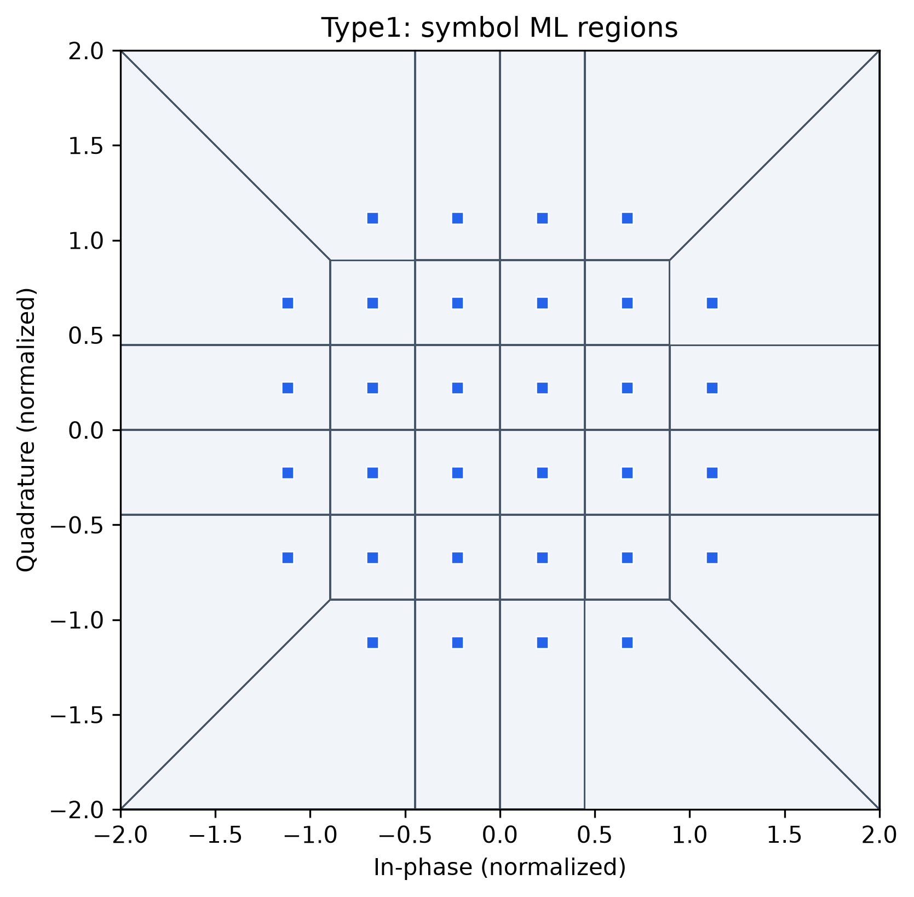
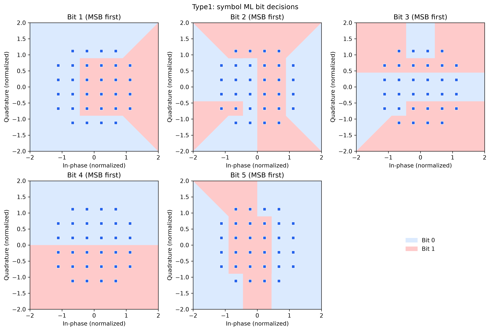
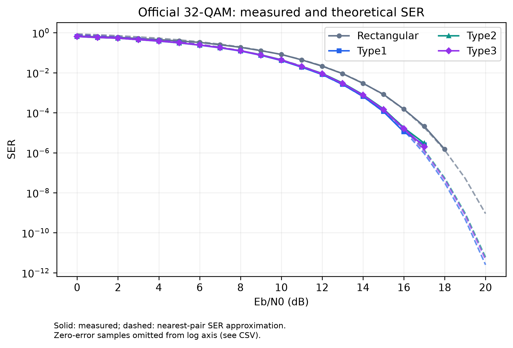
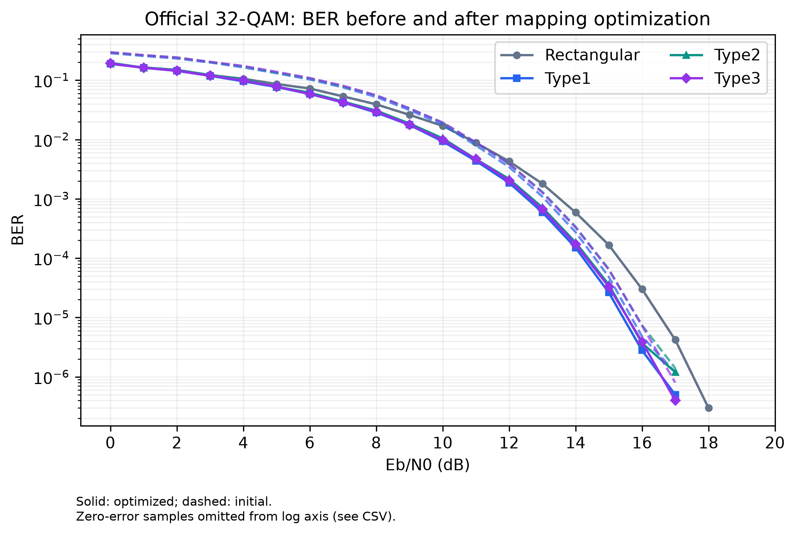
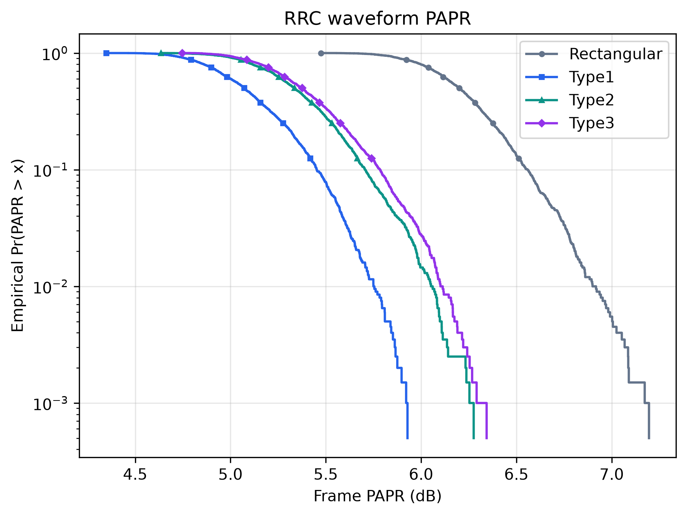

# 디지털통신 시스템설계 1 · 10조
## 32-QAM 성상도 최적화와 시나리오 기반 디지털통신 시스템 설계

| 작성자 | 이름 | 학번 |
| --- | --- | --- |
| 팀원 A |  |  |
| 팀원 B |  |  |
| 팀원 C |  |  |

## 목차

1. 서론
2. 목표 및 평가 방법
3. 설계
4. 이론적 분석
5. 실험
6. 시뮬레이터
7. 실험적 분석
8. 정성적 비교
9. 토론
10. 시나리오 기반 시스템 설계
11. 결론
12. 참고자료
13. 부록 및 자체평가

## 1. 서론

32-QAM은 심볼 하나에 5비트를 싣는다. 같은 평균 심볼 에너지에서도 점 배치가 바뀌면 판정 경계와 피크 전력이 달라지고, 같은 점 배치에서 라벨을 바꾸면 오판 한 건이 만드는 비트 오류 수가 달라진다. 본 연구는 교수님이 제시한 4×8 Rectangular와 세 가지 정수 격자 설계를 비교한다. 비교 결과를 드론 영상전송, 산업용 긴급 경보, PA 제약 이동단말의 운용 판단에 적용한다.

## 2. 목표 및 평가 방법

### 2.1 목표

각 격자에서 정규화 최소거리와 그 거리에 놓인 이웃 수를 기준으로 SER에 유리한 배치를 탐색한다. 확정 좌표에는 가까운 점끼리 라벨 차이가 작도록 Gray-like 매핑을 적용한다. 이후 SER, BER, PAPR, 수신 결정 복잡도, 대칭성을 공통 기준으로 평가한다.

### 2.2 현실적 제한요소

각 방식은 중복 없는 32점으로 구성하며 원시 I/Q 좌표는 −7~7의 정수이고 정규화 평균 심볼 에너지는 1이다. 설계 선택에는 PA의 선형 출력 한계와 송신전력, 수신기의 연산 예산, 서비스 지연과 전송률도 반영한다. 이 비교에서 회로 비용과 전력은 정성적으로 다루었다.

### 2.3 평가 방법

최근접 거리와 이웃 분포로 SER의 이론적 근사·경계를 구하고, 공식 AWGN Monte Carlo 결과와 비교한다. SER과 BER은 실측 오류 카운트로 계산한다. PAPR는 성상점과 RRC 송신 파형으로 나누어 평가한다. 수신기는 전수 및 구조 활용 판정의 연산 수와 일치 여부를, 대칭성은 원점·양 축 반사·90° 회전을 검사한다.

본문의 수치는 **공식 팀 설계**에 해당한다. 개발용 **교수님 예제 baseline**은 별도로 보존했으며, 공식 비교에는 제공된 Rectangular만 기준 방식으로 포함했다. [개발용 baseline 보존본](../analysis/baseline_results/rrc_sweep_verified/README.md)

## 3. 설계

### 3.1 설계 방법

원시 점을 $u_i=I_i+jQ_i$라 두고 $E_{s,\mathrm{raw}}=\sum_i |u_i|^2/32$, $s_i=u_i/\sqrt{E_{s,\mathrm{raw}}}$로 정규화했다. 각 Type은 32개 초기 배치에서 단일 점 교환을 반복했다. 정규화 최소거리 제곱을 우선 최대화하고, 동률에서는 그 거리에 놓인 비순서 점쌍이 적은 배치를 택했다. 탐색으로 얻은 후보의 전역 최적성은 미확정이다.

초기 비트 라벨은 점 식별자의 5자리 이진 표현이다. 시뮬레이티드 어닐링은 최소거리 점쌍의 해밍 거리 합을 줄이는 방향으로 라벨을 교환한다. 초기 배치 한 개와 무작위 배치 23개에서 시작하며, 배치당 최대 12,000회 교환을 시도한다. 온도는 2에서 0.08까지 낮추고 성상도별 시드는 20261128~20261131이다. 좌표와 식별자를 보존하면서 방식마다 32개의 라벨을 중복 없이 사용했다. [설계 근거](../docs/A_design.md) · [매핑 알고리즘](../simulation/mapping_optimizer.py)

### 3.2 Rectangular 32-QAM

교수님 기준 배열을 사용한다. I축의 4개 값은 ±1, ±3이고 Q축의 8개 값은 ±1, ±3, ±5, ±7이다. 모든 최소거리 쌍이 초기부터 1비트만 달라 기존 라벨을 유지했다.

### 3.3 Type1 32-QAM

I와 Q 모두 홀수인 64개 후보에서 32점을 골랐다. 표 1의 정규화 최소거리가 네 방식 중 가장 크다. 최종 비트 라벨은 표 2의 인접 해밍 거리 감소를 얻은 순열이다.

### 3.4 Type2 32-QAM

I와 Q 모두 짝수인 49개 후보에서 32점을 골랐다. 전역 최소거리의 평균 이웃 수는 네 방식 중 가장 적다. 확정 좌표에 동일한 Gray-like 매핑 절차를 적용했다.

### 3.5 Type3 32-QAM

I는 홀수, Q는 짝수인 56개 후보에서 32점을 골랐다. 두 축의 격자 제한이 다른 배치에 동일한 정규화와 비트 매핑 절차를 적용했다.

**표 1. 공식 성상도 기하와 성상도 그림**

| 방식 | 원시 평균 에너지 | 정규화 계수 | 정규화 최소거리 | 최소거리 이웃 평균¹ | 대표 점쌍과 초기 → 최종 라벨 | 정규화 성상도 |
| --- | --- | --- | --- | --- | --- | --- |
| Rectangular | 26.00 | 0.196116 | 0.392232 | 3.2500 | (1, 1) ↔ (1, 3): 00000 ↔ 00001 → 00000 ↔ 00001 | [그림 1a](../results/figures/constellations/constellation_rectangular.png) |
| Type1 | 20.00 | 0.223607 | 0.447214 | 3.2500 | (-5, -1) ↔ (-5, 1): 00001 ↔ 00010 → 00010 ↔ 00000 | [그림 1b](../results/figures/constellations/constellation_type1.png) |
| Type2 | 20.75 | 0.219529 | 0.439057 | 3.1250 | (-6, 0) ↔ (-6, 2): 00001 ↔ 00010 → 11000 ↔ 10000 | [그림 1c](../results/figures/constellations/constellation_type2.png) |
| Type3 | 20.50 | 0.220863 | 0.441726 | 3.1875 | (-5, -2) ↔ (-5, 0): 00001 ↔ 00010 → 00010 ↔ 00110 | [그림 1d](../results/figures/constellations/constellation_type3.png) |

¹ 각 점에서 전역 최소거리만큼 떨어진 이웃 수를 세고 평균했다.

방식별 32개 좌표와 최종 라벨은 아래 파일에 있다. 초기 라벨은 각 행의 식별자로 복원한다. [공식 좌표](../data/constellations.csv) · [최종 비트 매핑](../data/mapped_constellations.csv)

## 4. 이론적 분석

### 4.1 SER·BER 결정 경계

수신점 $r=s_i+n$에서 $n$은 복소 AWGN이고, $i$와 $j$는 성상점 인덱스다. 각 후보의 조건부 수신 밀도는 $\exp(-|r-s_j|^2/N_0)$에 비례하므로 최대우도 판정(ML)은 $\hat\imath=\arg\min_j|r-s_j|^2$이다. 후보 $s_i$의 영역은 모든 경쟁점 $s_j$에 대한 반평면 $2r\cdot(s_j-s_i)\le |s_j|^2-|s_i|^2$의 교집합이다. 내적은 복소 좌표를 I/Q 평면의 실수 벡터로 보고 계산한다. SER 결정 경계는 이 심볼 영역들의 경계다. BER 결정 영역은 같은 심볼 ML 판정의 결과에 최적화 라벨을 붙인 뒤, 각 비트 위치에서 0과 1로 나눈 영역이다.

*그림 2b. Type1의 심볼 ML 결정 영역. 나머지 방식의 경계는 아래 자료 목록에 있다.*

*그림 3b. 공식 매핑을 적용한 Type1의 5개 비트별 결정 영역.*

- 그림 2a–2d, 심볼 ML 결정 영역 — [Rectangular](../analysis/final_results/figures/ser_boundary_Rectangular.pdf), [Type1](../analysis/final_results/figures/ser_boundary_Type1.pdf), [Type2](../analysis/final_results/figures/ser_boundary_Type2.pdf), [Type3](../analysis/final_results/figures/ser_boundary_Type3.pdf).
- 그림 3a–3d, 비트별 결정 영역 — [Rectangular](../analysis/final_results/figures/ber_boundary_Rectangular.pdf), [Type1](../analysis/final_results/figures/ber_boundary_Type1.pdf), [Type2](../analysis/final_results/figures/ber_boundary_Type2.pdf), [Type3](../analysis/final_results/figures/ber_boundary_Type3.pdf).

### 4.2 이론적 SER

$N_0$는 잡음 전력 스펙트럼 밀도 매개변수이고, $\sigma^2=N_0/2$는 실수축별 잡음 분산이다. 거리 $d$인 경쟁점과의 이등분선을 넘을 확률은 $Q(d/(2\sigma))$이며 $Q(x)$는 표준정규의 오른쪽 꼬리확률이다. $C(d)$를 거리 $d$의 비순서 점쌍 수라 하면, 이론 합집합 상계는 $\min(1,\sum_d 2C(d)Q(d/(2\sigma))/32)$이다. 전역 최소거리 항만 남기면 최근접 근사를 얻는다. 하계는 각 송신점에서 가장 가까운 경쟁점 하나의 쌍별 확률을 평균한다. 저 SNR에서는 경쟁점별 오판 사건이 자주 겹치므로 합집합 상계가 느슨해지고, 높은 SNR에서는 가까운 경쟁점의 기여가 상대적으로 커진다.

### 4.3 이론적 BER과 Gray-like 매핑

점 $i$의 라벨을 $b_i$, 두 라벨의 해밍 거리를 $d_H(b_i,b_j)$라 하면 균등 심볼의 BER은 $\sum_i\sum_{j\ne i}P(\hat\imath=j\mid i)d_H(b_i,b_j)/(32\cdot5)$이다. 매핑 최적화는 $d_{\min}$에 놓인 점쌍의 해밍 거리 합에만 비용을 부여한다. 점간 전이확률은 좌표·채널·심볼 판정에 의해 정해져 동일하므로, 라벨 최적화의 영향은 BER에 나타난다.

**표 2. 최종 매핑의 최소거리 간선 지표**

| 방식 | 최소거리 쌍 수 | 평균 해밍 거리 초기 → 최적화 | Gray 간선 비율 초기 → 최적화 |
| --- | --- | --- | --- |
| Rectangular | 52 | 1.0000 → 1.0000 | 100.00% → 100.00% |
| Type1 | 52 | 2.1154 → 1.1538 | 30.77% → 92.31% |
| Type2 | 50 | 2.1400 → 1.1600 | 32.00% → 92.00% |
| Type3 | 51 | 2.1961 → 1.1373 | 31.37% → 86.27% |

Rectangular는 모든 최소거리 간선에서 Gray이다. Type1~3은 탐색 결과에서 일부 간선의 해밍 거리가 2 이상이며 완전 Gray 매핑의 존재 여부는 미확정이다.

### 4.4 PAPR

성상점 PAPR는 $\max_i|s_i|^2/E_s$이며, $E_s=\sum_i|s_i|^2/32=1$이다. 같은 정규화 배율이 최대·평균 전력에 적용되므로 비는 유지된다. 송신 파형은 $x(t)=\sum_i s_i p(t-iT)$로, $p(t)$는 RRC 펄스이고 $T$는 심볼 주기다. 연속 파형 PAPR는 프레임 구간의 최대 전력을 그 구간 평균 전력으로 나눈 값이며, 실험에서는 oversampling한 표본으로 각각 추정한다. 펄스 중첩의 교차항이 순간 피크를 바꾸므로 파형 PAPR와 성상점 PAPR를 구분한다. 이후 PAPR는 dB로 표시할 때 $10\log_{10}$을 적용한다.

### 4.5 구현 복잡도

전수 ML은 32개의 제곱거리와 31개의 후보 비교를 수행한다. 같은 I좌표를 갖는 점을 $G$개 열로 묶으면, 열별 최소 Q거리 항을 먼저 고른 뒤 I거리 항을 합산할 수 있다. 열 내부 비교 $32-G$회와 열 사이 비교 $G-1$회를 합쳐 여전히 31회이며, I거리 계산 횟수는 줄어든다. Rectangular는 모든 I/Q 조합이 있으므로 두 축의 최소화를 분리한다.

**표 3. 심볼당 연산 횟수**

| 구조 | 뺄셈 | 덧셈 | 곱셈 | 비교 |
| --- | --- | --- | --- | --- |
| 전수 ML · 공통 | 64 | 32 | 64 | 31 |
| Rectangular · 그룹 ML | 36 | 4 | 36 | 31 |
| Rectangular · 독립 I/Q | 12 | 0 | 12 | 10 |
| Type1 · 그룹 ML | 38 | 6 | 38 | 31 |
| Type2 · 그룹 ML | 39 | 7 | 39 | 31 |
| Type3 · 그룹 ML | 38 | 6 | 38 | 31 |

고정 길이 선형 탐색에서 평균과 최악 연산 수는 같다. 표는 뺄셈·덧셈·곱셈·비교를 세며 메모리 접근과 하드웨어 실행시간은 포함하지 않는다.

### 4.6 대칭성

원시 정수 좌표 집합을 원점 반전, I축 반사, Q축 반사, 90° 회전한 결과와 원본을 비교했다. I축 반사는 Q의 부호를, Q축 반사는 I의 부호를 바꾼다. 원점 대칭이고 심볼이 균등하면 평균 좌표는 0이다. 평균 좌표가 0이라는 조건만으로는 원점 대칭을 판정할 수 없다. 아래 평균값과 축 에너지는 정규화 좌표에서 산출했다.

**표 4. 공식 성상도의 평균·축 에너지·대칭성**

| 방식 | 평균 I | 평균 Q | I 에너지 | Q 에너지 | I/Q 공분산 | 원점·I축·Q축·90° (1=성립) |
| --- | --- | --- | --- | --- | --- | --- |
| Rectangular | 0.000000 | 0.000000 | 0.192308 | 0.807692 | 0.000000 | 1·1·1·0 |
| Type1 | 0.000000 | 0.000000 | 0.500000 | 0.500000 | 0.000000 | 1·1·1·1 |
| Type2 | -0.096044 | -0.041162 | 0.524096 | 0.475904 | 0.014119 | 0·0·0·0 |
| Type3 | -0.069020 | 0.000000 | 0.463415 | 0.536585 | 0.000000 | 0·1·0·0 |

## 5. 실험

### 5.1 실험 방법

공식 좌표와 매핑의 점 식별자 및 정규화 좌표가 일치하는지 확인했다. 각 성상도·SNR에서 한 번 생성한 송신점과 독립 I/Q AWGN 표본으로 심볼을 판정하고, 결과를 두 매핑에 함께 적용했다. 전송 심볼 수 $N$, 관측 심볼 오류 수 $n_s$, 관측 비트 오류 수 $n_b$에 대해 관측 SER은 $n_s/N$, BER은 $n_b/(5N)$이다. 별도로 동일 수신점 표본에서 전수 ML과 그룹 ML 및 Rectangular 독립 I/Q의 판정 일치 여부를 검증했다.

### 5.2 실험 변수

**표 5. 공통 실험 조건**

| 실험 | 변수 | 설정 |
| --- | --- | --- |
| AWGN | 변조·입력 | 비부호화 32-QAM, 심볼당 5비트, 각 점 확률 1/32, $E_s=1$ |
| AWGN | 신호 대 잡음비 | $E_b/N_0$ 0–20 dB, 간격 1 dB |
| AWGN | 난수·종료 | C++ MT19937, 시드 20261128 + Eb/N0의 정수 dB값. 지점당 심볼 오류 2,000회 또는 전송 2,000,000심볼 |
| 수신기 | 판정 비교 | 네 방식에 공통 수신점 10,000개, 시드 2026 |
| 파형 | RRC | 기본 roll-off 0.35, 8 SPS. 비교 roll-off 0.15·0.35·0.60과 4·8·16·32 SPS |
| 파형 | 프레임 | 시드 2026, 조건당 2,000프레임, 중앙 512심볼 집계, 양쪽 8심볼 가드, 필터 길이 10심볼 구간, 군지연 보상 |

$\gamma_b=10^{(E_b/N_0)_{\mathrm{dB}}/10}$를 선형 비트 SNR로 둔다. $E_b=E_s/5$이고 $E_s/N_0=5\gamma_b$이므로 축별 분산은 $\sigma^2=1/(10\gamma_b)$다. SPS는 심볼당 표본 수다. RRC 비교에서는 성상도와 필터 조건에 걸쳐 동일한 난수 심볼 인덱스 시퀀스를 사용했다.

## 6. 시뮬레이터

### 6.1 구조

Python에서 성상도를 검증하고 최적화 매핑을 작성한다. C++는 CSV의 점과 라벨을 읽어 송신점 선택, AWGN 합성, 최소거리 수신 판정, 오류 카운트와 결과 출력을 수행한다. Python에서 이론·실험 CSV를 결합하고 결정 영역과 파형을 계산한다.

### 6.2 주요 코드

교수님 원본의 QAMa 성상점 할당·변복조와 MaryModulation의 오류 집계를 재사용했다. 팀 실험 진입점은 mapped CSV를 점 식별자 순으로 읽고, 잡음이 없을 때 32점이 원래의 라벨로 복조되는지 검사한다. 수신 심볼을 한 번 판정한 후 초기·최적화 라벨의 비트 오류를 따로 계산한다. [팀 실험 진입점](../simulation/LinkLevelSimulation/rectangular_experiment.cpp)

### 6.3 프로그래밍 수정

팀 진입점은 원본의 $E_s/N_0$용 설정 대신 $E_b/N_0$를 입력받아 표 5의 축별 가우시안 표준편차를 정확히 적용한다. 원본의 균등 난수 합 기반 가우시안 근사 대신 표준 라이브러리 정규분포를 사용했다. 원본 최소거리 탐색의 초깃값은 첫 후보의 실제 거리로 두고, 기존 텍스트 출력은 최초 초기화 시 열도록 수정했다. [원본 변경 패치](../simulation/LinkLevelSimulation/professor-adaptation.patch) · [빌드 및 실행](../simulation/README.md)

## 7. 실험적 분석

### 7.1 SER 성능

**표 6. 10 dB에서의 관측 SER과 이론 SER**

| 방식 | 전송 심볼 | 심볼 오류 | 관측 SER | 최근접 근사 | 이론 하계 | 이론 상계 |
| --- | --- | --- | --- | --- | --- | --- |
| Rectangular | 24,255 | 2,000 | 0.082457 | 0.081023 | 0.024930 | 0.088434 |
| Type1 | 49,055 | 2,000 | 0.040771 | 0.041189 | 0.012674 | 0.043451 |
| Type2 | 44,973 | 2,000 | 0.044471 | 0.043974 | 0.014072 | 0.046728 |
| Type3 | 46,594 | 2,000 | 0.042924 | 0.043351 | 0.013600 | 0.045933 |

10 dB에서 이론 최근접 근사와 관측값의 최대 절대차는 0.001435 미만이다. 0 dB의 Rectangular는 최근접 근사 0.869608, 관측값 0.683293으로 차이가 더 컸다. 이론 상·하계는 실제 확률을 제한하며 유한 표본의 관측 비율은 표본 변동으로 경계를 벗어날 수 있다. 관측 SER 최저는 0·1·3·5 dB에서 Type2, 2·4·6–16 dB에서 Type1, 17 dB에서 Type3였다. 각 성상도·SNR의 초기·최적화 84쌍은 전송 심볼 수와 심볼 오류 수가 정확히 일치했다.

*그림 4. 관측 SER과 최근접 이론 근사. 전체 이론 경계와 관측 카운트는 표 6의 원본 CSV를 참조한다.* [이론 SER](../results/metrics/theoretical_ser.csv) · [전체 관측값](../results/metrics/simulation_results.csv)

### 7.2 BER 성능

**표 7. 10 dB에서 초기 대비 최적화 매핑의 관측 BER**

| 방식 | 전송 비트 | 비트 오류 초기 → 최적화 | 관측 BER 초기 → 최적화 | 상대 감소율 |
| --- | --- | --- | --- | --- |
| Rectangular | 121,275 | 2,060 → 2,060 | 0.016986 → 0.016986 | 0.00% |
| Type1 | 245,275 | 4,361 → 2,286 | 0.017780 → 0.009320 | 47.58% |
| Type2 | 224,865 | 4,325 → 2,359 | 0.019234 → 0.010491 | 45.46% |
| Type3 | 232,970 | 4,509 → 2,298 | 0.019354 → 0.009864 | 49.04% |

Type1~3은 0–17 dB 전 지점에서 최적화 매핑의 관측 BER이 낮아졌다. Rectangular는 같은 라벨을 유지해 변화가 없었다. 최적화 BER 최저는 0·2–16 dB에서 Type1, 1·17 dB에서 Type3였다. 17 dB에서 세 Type의 심볼 오류는 각각 5·6·4회로 적어 순위에 표본 변동이 크다.

18–20 dB에서 Type1~3, 19–20 dB에서 Rectangular는 지점당 200만 심볼에서 오류가 관측되지 않았다. 독립 심볼 오류를 가정한 지점별 단측 95% 이항 SER 상한은 $1-0.05^{1/2{,}000{,}000}\approx 1.50\times10^{-6}$이다. 그림 4·5의 로그 축에는 오류 0회 지점을 표시하지 않고 원본 CSV의 오류 수로 보고한다.

*그림 5. 공식 관측 BER. 실선은 최적화, 점선은 초기 매핑이다.* [전체 매핑 비교](../analysis/final_results/paired_ser_ber.csv)

### 7.3 PAPR 성능

**표 8. 공식 성상점 PAPR와 기본 RRC 조건의 파형 PAPR**

| 방식 | 성상점 PAPR (dB) | 파형 평균 (dB) | 파형 P95 (dB) | 파형 P99 (dB) |
| --- | --- | --- | --- | --- |
| Rectangular | 3.484546 | 6.215514 | 6.675754 | 6.899573 |
| Type1 | 2.304489 | 5.093673 | 5.561601 | 5.749793 |
| Type2 | 2.850419 | 5.353123 | 5.824525 | 6.051795 |
| Type3 | 3.010300 | 5.398543 | 5.896386 | 6.101589 |

파형 평균은 프레임별 dB 값의 산술평균이다. P95와 P99는 프레임 PAPR 분포의 95·99백분위수이며, CCDF는 $P(\mathrm{PAPR}>x)$이다. Type1은 성상점 PAPR가 가장 낮고, roll-off·SPS 12개 조합에서도 모두 가장 낮은 파형 P99를 보였다. 표 8에서 Type1은 Rectangular보다 성상점 PAPR가 1.180057 dB, 파형 P99가 1.149780 dB 낮았다. 전체 조건에서 32 SPS와 비교한 P99 최대 절대차는 4·8·16 SPS에서 각각 0.03876·0.03367·0.00690 dB였다. 32 SPS도 연속 파형에 대한 이산 근사다.

*그림 6. 기본 조건의 RRC 파형 PAPR CCDF. roll-off 0.35, 8 SPS, 방식별 2,000프레임.* [RRC 48개 조합 요약](../analysis/final_results/waveform_papr_summary.csv)

## 8. 정성적 비교

### 8.1 현실적 제한요소

Rectangular의 독립 I/Q 판정은 비교한 수신 구조 중 산술·비교 횟수가 가장 적다. Type1의 그룹 ML은 전수 판정보다 산술량을 줄이지만 Rectangular의 독립 판정보다 연산이 많다. 방식별 공통 수신점 10,000개에서 그룹 ML과 전수 ML의 불일치는 모두 0회였고, Rectangular 독립 판정도 일치했다. 실제 칩 비용, 처리 지연과 소비전력은 해당 하드웨어에서 확인해야 한다.

낮은 파형 PAPR는 주어진 피크 한계에서 평균 출력 여유를 비교하는 근거다. 본 연구에서는 **PA 비선형 왜곡과 실제 전력 효율을 직접 측정하지 않았다.** EVM, 인접 채널 누설 및 허용 백오프는 실장 PA 특성으로 평가해야 한다.

### 8.2 제안 방식의 우수성

**표 9. 공식 다섯 성능 지표의 비교 결론**

| 필수 지표 | 공식 비교의 결론 |
| --- | --- |
| SER | 10 dB와 6–16 dB의 관측값은 Type1이 최저. 일부 저 SNR에서는 Type2가 최저 |
| BER | 10 dB의 최적화 관측값은 Type1이 최저. 1·17 dB에서는 Type3가 최저 |
| PAPR | Type1이 성상점 PAPR와 모든 비교 조건의 파형 P99에서 최저 |
| 수신 결정 복잡도 | Rectangular의 독립 I/Q가 가장 적은 연산을 요구 |
| 대칭성 | Type1이 원점·양 축 반사·90° 회전의 네 기준을 모두 충족 |

[전체 지점의 통합 CSV](../analysis/final_results/final_comparison.csv)

## 9. 토론

### 9.1 최적화 목표

SER을 우선하면 정규화 최소거리와 인접 점의 수를 함께 본다. BER을 우선하면 라벨의 해밍 거리뿐 아니라 송신점에서 각 경쟁점으로 오판할 확률도 중요하다. PA 제약이 강하면 파형 PAPR의 상위 분위수, 수신 전력 예산이 작으면 판정 구조를 우선할 수 있다. 가중치와 운용 조건이 달라지면 설계 순위도 달라진다.

### 9.2 128-QAM으로 확장

현재 좌표 제한의 후보 수는 어느 Type에서도 128에 미달한다. 예를 들어 정수 좌표 범위를 −12~12로 확장하면 홀수 12개, 짝수 13개를 각 축에 사용할 수 있어 세 격자 모두 128점을 선택할 수 있다. 128점으로 평균 에너지를 다시 계산하고 $E_s/N_0=7E_b/N_0$를 적용한다. 늘어난 점쌍의 거리 히스토그램은 교환 시 증분 갱신할 수 있으며, 라벨은 7비트로 확장한다.

### 9.3 시뮬레이션 방법과 재현

C++로 반복 송수신과 오류 집계를 수행하고 Python으로 좌표 검색, 매핑, 수치 대조, 시각화를 수행했다. 공식 Monte Carlo는 Windows x64의 MSVC Release 환경에서 재실행·검증했으며, 표준 라이브러리 구현이 다르면 난수열이 달라질 수 있다. C의 재현 절차는 B의 공식 관측 CSV로 결정 영역과 통합표를 다시 만드는 절차다. [Monte Carlo 재현](../simulation/README.md) · [공식 산출물 재현](../analysis/final_results/README.md)

## 10. 시나리오 기반 시스템 설계

### 10.1 세 시나리오 비교

**표 10. KPI, 선택과 변경 요청 대응**

| 항목 | 4 · Drone 실시간 영상전송 | 5 · 산업용 긴급 Alarm | 9 · PA 제약 이동단말 |
| --- | --- | --- | --- |
| 가장 중요한 KPI | PHY의 BER 및 기한 내 영상 전달 | 기한 내 올바른 경보 전달 실패확률 | 피크 한계 내 평균 송신전력. 파형 P99로 여유 비교 |
| 두 번째 KPI | PAPR | 종단 간 지연과 마감시간 충족 | 운용 Eb/N0에서의 BER |
| 낮은 우선순위 | 성상도 대칭성 | 최대 전송률 | 성상도 대칭성 |
| 선택 | 링크 여유를 충족하면 최적화 Type1 32-QAM | 동기 Gray QPSK | BER·피크·수신 처리 예산 충족 시 최적화 Type1 |
| 선택 이유 | 10 dB 관측 BER 0.009320, 기본 파형 P99 5.750 dB, 심볼당 5비트 | 같은 10 dB에서 QPSK 이론 BER 3.87×10⁻⁶, Type1 관측 BER 9.32×10⁻³. 같은 심볼률에서 96비트 예시가 BPSK 96심볼에서 QPSK 48심볼로 감소 | Rectangular 대비 파형 P99 1.150 dB 감소, 10 dB에서 관측 BER도 감소 |
| 포기한 성능 | 독립 I/Q 판정의 단순성. 변조 차수를 낮추면 영상 전송률이 감소 | 동일 심볼률에서 비부호화 명목 비트율은 32-QAM의 40%. 96비트 예시는 20→48심볼 | 독립 I/Q 대비 그룹 ML의 심볼당 곱셈 12→38회, 비교 10→31회 |
| 변경 요청 이후 | 거리 2배 시 자유공간 경로손실 약 6.02 dB 증가. 목표를 유지하면 Type1, 미달이면 16-QAM 또는 QPSK와 영상률 조정 | 실패 목표가 강화되면 CRC 포함 프레임을 측정하고 짧은 FEC를 검토. 기한에 여유가 있으면 반복, 전력·시간 한계에 따라 BPSK 평가 | 저가 PA로 피크 한계가 낮아지면 평균 출력과 링크 BER을 재계산. 조건을 만족하면 Type1을 유지하고 미달이면 저차 변조 검토 |

Alarm에서 BER 이론값은 동기 Gray QPSK의 $Q(\sqrt{2\gamma_b})$를 사용했다. QPSK와 BPSK는 같은 수신 $E_b/N_0$에서 이론 BER이 같으며, 심볼 수 비교는 같은 심볼률을 가정한다. 96비트는 예시 길이이고 동기 오버헤드는 제외했다. 이론 BER과 공식 32-QAM의 Monte Carlo 관측 BER은 패킷 실패율과 구분한다. PA 후보 평가는 프레임 P99에 근거하며 실제 백오프 또는 전력 효율의 실측 결과는 없다. [Drone 근거](../docs/scenarios/scenario_drone.md) · [Alarm 근거](../docs/B_report_draft.md#10-scenario-5-산업용-긴급-alarm) · [PA 근거](../docs/scenarios/scenario_pa.md)

### 10.2 공통 질문

1. **Part A의 종합 우수 방식이 모든 시나리오에서 가장 우수한가?** Type1은 10 dB에서 공식 4종의 관측 오류율과 파형 P99가 낮아 Drone과 PA의 조건부 선택이다. 짧은 경보의 기한 내 신뢰성이 우선인 Alarm에서는 Gray QPSK를 선택했다.
2. **최적 성상도의 의미는 요구사항에 따라 어떻게 달라지는가?** 공식 4종에서도 0 dB의 관측 SER 최저는 Type2, 10 dB에서는 Type1이다. 수신 연산 최소화가 가장 중요하다면 Rectangular의 독립 I/Q가 유리하다.
3. **한 성능을 개선하면 다른 지표는 어떻게 달라지는가?** Type1은 Rectangular보다 10 dB 오류율과 파형 P99가 낮지만 그룹 ML 연산을 더 요구한다. 반면 좌표가 같은 상태에서 매핑만 최적화하면 Type1의 10 dB SER은 0.040771로 같고 BER은 0.017780에서 0.009320으로 낮아진다. Alarm의 QPSK 선택은 명목 비트율을 줄여 신뢰성 여유를 얻는 설계다.
4. **실제 제품에 무엇을 추가로 고려해야 하는가?** Drone은 거리·자세·페이딩과 영상 마감시간, Alarm은 동기화·CRC·FEC·간섭에 따른 반복 실패 상관과 종단 간 지연, PA 단말은 출력 한계·EVM·인접 채널 누설과 배터리 소비를 확인한다. 대상 수신 회로의 처리 지연·전력도 함께 평가한다.

## 11. 결론

### 11.1 결론

공식 Type1은 네 후보 중 정규화 최소거리가 가장 크고, 10 dB에서 관측 SER 0.040771과 BER 0.009320으로 가장 낮았다. 성상점 PAPR 2.304489 dB와 기본 RRC 파형 P99 5.749793 dB도 가장 낮았으며 대칭 네 기준을 모두 충족했다. 수신 연산은 Rectangular의 독립 I/Q가 가장 적었다. 같은 송수신 심볼로 비교한 84쌍에서 매핑 전후 SER은 모두 같았고 Type1~3의 관측 BER은 오류가 관측된 0–17 dB에서 감소했다. 이 차이를 적용해 Drone과 PA에는 조건부 Type1, Alarm에는 Gray QPSK를 제안했다.

### 11.2 향후 할 일

설계 운용점을 확정하려면 Drone의 실제 채널과 영상 마감률, Alarm의 프레임 실패확률과 종단 간 지연, PA 단말의 실제 비선형 출력·전력 효율을 검증해야 한다. 매우 낮은 오류율 구간에는 더 많은 심볼 또는 신뢰구간을 사용한 검증이 필요하다. 대상 하드웨어에서 후보 수신기의 처리 지연과 소비전력을 측정해 연산 비교와 연결할 수 있다.

## 12. 참고자료

1. 디지털통신 시스템설계 1 과제 원본 PDF와 교수님 제공 LinkLevelSimulation 소스.
2. [A 설계·이론 분석](../docs/A_design.md), [B 매핑·실험 및 Alarm](../docs/B_report_draft.md), [C 분석 및 검증 기록](../docs/C_analysis.md).
3. [공식 좌표](../data/constellations.csv), [최적화 매핑](../data/mapped_constellations.csv), [공식 이론 SER](../results/metrics/theoretical_ser.csv), [공식 Monte Carlo CSV](../results/metrics/simulation_results.csv), [C 최종 분석 및 재현 기록](../analysis/final_results/README.md).

## 13. 부록 및 자체평가

### 13.1 자체평가

**표 11. 과제 원본의 자체평가 항목과 배점**

| 번호 | 평가 항목 | 점수 배점 | 자체평가 점수 |
| ---: | --- | ---: | ---: |
| 1 | 목표·기능·성능 설정과 제한조건 접근 및 평가 방법이 적절한가 | 10점 |  |
| 2 | 설계 규격이 간결하고 명확한가 | 10점 |  |
| 3 | 이론적 분석 방법과 결과가 적절한가 | 10점 |  |
| 4 | 실험적 분석 방법과 결과가 적절한가 | 10점 |  |
| 5 | 시뮬레이션 방법과 시뮬레이터를 충분히 이해했는가 | 10점 |  |
| 6 | 제안 규격이 목표·기능·성능·제한조건을 충족하는가 | 10점 |  |
| 7 | 시나리오 비교 분석 및 설계가 적절한가 | 10점 |  |
| 8 | 관련 지식이 충분하며 교과목 내용을 설계에 적용했는가 | 10점 |  |
| 9 | 보고서가 논리적이고 간결하며 제한된 시간 안에 이해하기 쉬운가 | 10점 |  |
| 10 | 창의성과 독창성이 있는가 | 10점 |  |
| 11 | 두 개 이상 보고서에서 같은 결과 또는 문장이 확인되는 경우 | −100점 |  |
| 12 | Copy Killer에서 다른 문서와의 중복이 확인되는 경우 | −100점 |  |
| 13 | 과제와 무관한 내용을 포함하는 경우 | 0~−100점 |  |
|  | **합계** | **100점** |  |

### 13.2 코드 및 데이터 버전

- A의 공식 좌표는 커밋 `2a5d016`, B의 최종 실험 산출물은 `86b6cb0`을 사용했다. 파일별 해시는 [공식 실행 기록](../results/metrics/optimized_run_receipt.json)에서 확인할 수 있다.
- [시뮬레이터 변경 패치](../simulation/LinkLevelSimulation/professor-adaptation.patch), [C 분석 코드](../analysis/analyze.py), [통합 코드](../analysis/integrate_final.py), [C 재현 메타데이터](../analysis/final_results/run_metadata.json).
- [공식 4종 × 21 SNR의 통합 CSV](../analysis/final_results/final_comparison.csv)와 [최종 그림 및 표 목록](../analysis/final_results/README.md).
